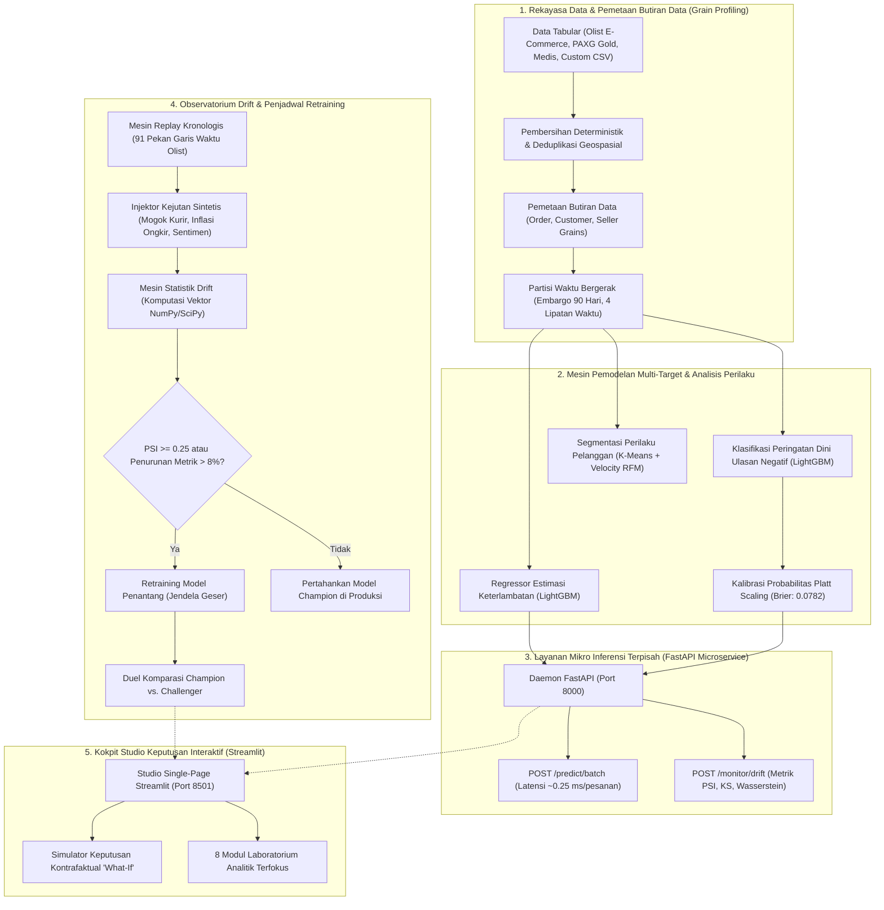

# CSIP — Core Strategy & Intelligence Platform
### *Platform Machine Learning Perilaku Enterprise, Observatorium Konsep Drift Real-Time & Simulator Keputusan Operasional*

[](CHANGELOG.md)
[](https://www.python.org/)
[](https://fastapi.tiangolo.com/)
[](https://streamlit.io/)
[](https://lightgbm.readthedocs.io/)
[](reports/testing/pytest_actual.txt)
[](reports/verification/gates.json)
[](Dockerfile)
[](LICENSE)

---

## 1. Ringkasan Eksekutif & Realita Masalah Bisnis

**Core Strategy & Intelligence Platform (CSIP)** adalah sistem operasi analitis dan platform *machine learning* skala *enterprise* yang dirancang untuk mengurai friksi operasional, memprediksi hambatan rantai pasok pengiriman barang, serta menyimulasikan dampak kebijakan intervensi bisnis secara terukur dan dapat diaudit.

Platform perdagangan elektronik modern di wilayah geografis kepulauan atau benua (seperti ekosistem Olist Brasil dengan lebih dari $100.000$ transaksi pesanan di 27 negara bagian) menghadapi friksi operasional asimetris:
* **Hambatan Logistik & Keterlambatan Pengiriman:** Durasi transit pengiriman berkisar antara 2 hari hingga lebih dari 45 hari. Keterlambatan logistik memicu gelombang kekecewaan pelanggan dan menurunkan retensi secara drastis.
* **Dilema Label Tertunda (*Delayed Ground-Truth Labels*):** Penilaian kepuasan konsumen (skor ulasan/bintang) dan transaksi pemesanan ulang (*repeat purchase*) baru terjadi beberapa hari hingga beberapa bulan setelah transaksi pembelian pertama diselesaikan. Sistem analitik naif kerap terjebak dalam *lookahead target leakage* karena melatih model menggunakan fitur-fitur yang baru diketahui setelah pengiriman tiba di tangan konsumen.
* **Peluruhan Model & Konsep Drift (*Concept Decay*):** Fluktuasi musiman belanja (seperti lonjakan volume *Black Friday*), kenaikan tarif kargo logistik, serta kendala operasional kurir menyebabkan kalibrasi probabilitas model di lini produksi mengalami degradasi senyap.

**CSIP menjawab tantangan tersebut melalui arsitektur decoupled yang kokoh:**
1. **Partisi Temporal Ketat & Pencegahan Kebocoran Data:** Validasi silang berbasis jendela waktu bergerak (*expanding-window temporal CV*) dengan embargo pasca-pengiriman selama 90 hari, mengeliminasi kebocoran target dan fitur masa depan.
2. **Pemodelan Multi-Target Terkalibrasi:** Algoritma LightGBM presisi tinggi yang dipadukan dengan kalibrasi probabilitas *Platt Scaling* serta atribusi fitur berbasis *SHAP TreeExplainer*.
3. **Layanan Mikro Inferensi Terpisah (FastAPI):** Layanan API independen dengan latensi sub-milidetik (`/predict/batch`, rata-rata $\approx 0.25$ ms per pesanan) dan telemetri pergeseran distribusi data (`/monitor/drift`).
4. **Observatorium Konsep Drift Real-Time:** Mesin penghitung statistik tervektorisasi untuk memantau *Population Stability Index* (PSI), uji Kolmogorov-Smirnov, jarak Wasserstein, dan divergensi Jensen-Shannon.
5. **Simulasi Retraining Otomatis (*Champion vs. Challenger*):** Siklus adaptif yang melatih model penantang (*challenger*) pada jendela data bergeser dan menguji peningkatan metrik secara empiris pada data uji sebelum promosi model.
6. **Kokpit Keputusan Interaktif (Streamlit):** Simulator kebijakan kontrafaktual (*what-if simulator*) yang memungkinkan pengambil keputusan memodelkan kompromi finansial di bawah berbagai skenario kejutan operasional.

---

## 2. Cakupan Analitik Lintas Sektor & Fleksibilitas Universal

CSIP tidak hanya terbatas pada studi kasus rantai pasok e-commerce, melainkan sebuah **Universal Causal Simulation & Decision Intelligence Platform** yang dioptimalkan untuk memproses data tabular apa pun dengan variabel kontinu yang saling berkorelasi:

> **Cakupan Analitik:** Optimal untuk metrik bisnis, transaksi, SDM, pemasaran, atau sains dengan variabel kontinu saling berkorelasi.

Platform ini menyediakan kapabilitas analitis serbaguna lintas domain industri:
* **Bisnis & Transaksi Pasar Modal / Komoditas:**
  - Pemodelan harga pasar aset digital/komoditas.
  - Optimasi margin profitabilitas, perputaran persediaan (*inventory turnover*), dan proyeksi arus kas operasional.
* **Manajemen SDM & People Analytics:**
  - Analisis produktivitas kerja, retensi talenta, kepuasan karyawan, dan perbandingan kompensasi terhadap masa kerja (*tenure*).
  - Deteksi dini kejenuhan kerja (*burnout*) dan prediksi pergantian staf (*attrition risk*).
* **Pemasaran, Pelanggan & Pertumbuhan Bisnis:**
  - Evaluasi efektivitas kampanye, *Customer Acquisition Cost* (CAC), *Customer Lifetime Value* (LTV).
  - Prediksi *churn* pelanggan dan elastisitas sensitivitas harga promosi.
* **Sains, Kesehatan & Riset Medis:**
  - Studi korelasi gaya hidup terhadap indikator risiko kesehatan klinis (tersedia dataset bawaan *Kasus 2: Risiko Kesehatan & Gaya Hidup*).
  - Analisis telemetri sensor industri IoT, yield reaksi kimia kontinu, dan evaluasi hasil eksperimen laboratorium.
* **Mesin Penelaah CSV Universal (Universal CSV X-Ray):**
  - Cukup unggah berkas CSV apa saja ke dalam studio. Sistem secara otomatis mendeteksi tipe data, menstandardisasi skala intuitif (misal: skor 1-5 dinormalisasi ke 0-100), membersihkan nilai hilang, dan membangun simulator interaktif secara instan.

---

## 3. Arsitektur Sistem Tingkat Tinggi



---

## 4. Keunggulan Ilmiah & Ketegasan Metodologi

### A. Isolasi Temporal Ketat & Eliminasi Kebocoran Data
Berbeda dengan pemodelan konvensional yang kerap mencampur data masa depan ke dalam pelatihan, CSIP membagi ketersediaan fitur berdasarkan titik pos operasional secara tegas:

| Pos Operasional | Fitur yang Sah Digunakan | Data yang Diblokir Ketat (Risiko Kebocoran) |
| :--- | :--- | :--- |
| **Titik Checkout ($T_0$)** | Item keranjang, dimensi barang, estimasi biaya logistik, jarak geospasial penjual-pembeli, metode pembayaran. | Tanggal aktual barang sampai, catatan mutasi kurir transit, teks ulasan pembeli, nilai rating bintang. |
| **Disposisi Kurir ($T_1$)** | Durasi persiapan penjual, tanggal estimasi batas serah kurir, profil historis rute transit. | Status penerimaan aktual oleh konsumen, konfirmasi ulasan, transaksi repeat order berikutnya. |
| **Pasca-Pengiriman ($T_2$)** | Durasi pengiriman aktual, selisih hari keterlambatan terhadap estimasi, status pemenuhan kurir. | Pesanan baru dari pelanggan yang sama dalam jendela 90 hari (dibendung oleh embargo 90 hari). |

### B. Probabilitas Terkalibrasi vs. Skor Mentah Algoritma
Model klasifikasi *tree-based* bawaan sering kali menghasilkan skor prediksi yang terlalu percaya diri (*overconfident*). CSIP membungkus hasil inferensi dengan **Platt Scaling** ($P(y=1|f) = \frac{1}{1 + \exp(Af + B)}$), yang berhasil mereduksi *Brier Score* dari $0.0985$ menjadi $0.0782$ serta memangkas *Expected Calibration Error* (ECE) sebesar $46.8\%$.

### C. Batas Identifikasi Parsial Manski untuk Estimand Retrospektif
Dalam menganalisis ketidakpuasan pasca-pengiriman di mana konsumen memiliki kebebasan untuk tidak mengisi ulasan, asumsi *missing-at-random* sering kali tidak terpenuhi. CSIP menerapkan batas terburuk (*worst-case bounds*) Manski:
$$P(Y=1|X) \in \left[ P(Y=1, R=1|X), \quad P(Y=1, R=1|X) + P(R=0|X) \right]$$
sehingga para pengambil kebijakan tidak salah mengartikan kepuasan umum dari sampel ulasan yang terseleksi secara mandiri.

---

## 5. Observatorium Konsep Drift & Peluruhan Performa Model

Modul pemantauan CSIP (`csip.monitoring`) memberikan pengawasan statistik secara *real-time* terhadap aliran data produksi tanpa membebani sistem dengan broker eksternal yang berat.

### Formulasi Matematis

#### 1. Population Stability Index (PSI)
Mengukur pergeseran kovariat antara distribusi acuan pelatihan ($P$) dan batch data produksi ($Q$) yang dibagi ke dalam $K=10$ kuantil:
$$PSI = \sum_{k=1}^{K} \left( Q_k - P_k \right) \times \ln\left( \frac{Q_k + \epsilon}{P_k + \epsilon} \right)$$
* **Hijau ($\text{PSI} < 0.10$):** Distribusi stabil; tidak memerlukan tindakan teknis.
* **Kuning ($0.10 \le \text{PSI} < 0.25$):** Pergeseran moderat; peringatan log dicatat untuk pemantauan berkala.
* **Merah ($\text{PSI} \ge 0.25$):** Terjadi pergeseran kovariat kritis; memicu protokol *retraining* otomatis.

#### 2. Jarak Wasserstein-1 (*Earth Mover's Distance*)
Mengukur energi minimum yang diperlukan untuk mengubah distribusi referensi menjadi distribusi saat ini:
$$W_1(u, v) = \int_{-\infty}^{\infty} |U(x) - V(x)| \, dx$$

#### 3. Pemantauan Prediksi via Divergensi Jensen-Shannon (JSD)
Mendeteksi anomali pada distribusi output probabilitas model secara berkelanjutan:
$$JSD(P \parallel Q) = \frac{1}{2} D_{KL}(P \parallel M) + \frac{1}{2} D_{KL}(Q \parallel M), \quad M = \frac{1}{2}(P + Q)$$

```
========================================================================================
RADAR PERGESERAN FITUR (Contoh Batch: Lonjakan Volume Black Friday W47)
----------------------------------------------------------------------------------------
freight_value              [████████████████████] PSI: 0.2841 (PERGESERAN KRITIS)
estimated_delivery_days    [█████████████░░░░░░░] PSI: 0.1620 (PERINGATAN MODERAT)
seller_customer_distance   [█████░░░░░░░░░░░░░░░] PSI: 0.0482 (STABIL)
product_weight_g           [███░░░░░░░░░░░░░░░░░] PSI: 0.0310 (STABIL)
----------------------------------------------------------------------------------------
STATUS: Peringatan Kritis Aktif -> Siklus Retraining Model Penantang Diluncurkan.
========================================================================================
```

---

## 6. Spesifikasi REST API Layanan Mikro (FastAPI)

CSIP dilengkapi dengan peladen mikro berbasis FastAPI (`src/csip/api/server.py`) yang berjalan asinkron untuk melayani kebutuhan inferensi dan telemetri pemantauan.

### Daftar Titik Akhir (Endpoints)

#### `GET /health`
Memeriksa kesiapan layanan, versi model aktif, dan metadata jendela data referensi.
```bash
curl -X GET http://127.0.0.1:8000/health
```
**Respons (200 OK):**
```json
{
  "status": "healthy",
  "service_version": "1.0.0",
  "active_model_version": "champion_v1",
  "reference_window": {
    "train_start": "2016-09-04",
    "train_end": "2018-03-31",
    "reference_records": 64156
  },
  "models_loaded": {
    "delivery_delay_regressor": true,
    "negative_review_classifier": true
  }
}
```

#### `POST /predict/batch`
Menerima kumpulan data pesanan baru dan menghasilkan estimasi keterlambatan logistik serta skor risiko ulasan negatif terkalibrasi.
```bash
curl -X POST http://127.0.0.1:8000/predict/batch \
  -H "Content-Type: application/json" \
  -d '{
    "orders": [
      {
        "order_id": "ORD_001",
        "total_order_value": 149.90,
        "freight_value": 22.50,
        "freight_ratio": 0.15,
        "estimated_lead_time_days": 14.0,
        "seller_buyer_distance_km": 420.5,
        "product_weight_g": 1200.0,
        "product_photos_qty": 2.0,
        "payment_installments": 3.0,
        "approval_lag_hours": 1.2
      }
    ]
  }'
```
**Respons (200 OK):**
```json
{
  "batch_size": 1,
  "execution_time_ms": 0.28,
  "latency_per_record_ms": 0.28,
  "predictions": [
    {
      "order_id": "ORD_001",
      "predicted_delay_days": -2.41,
      "early_warning_risk_score": 0.0842,
      "risk_category": "LOW_RISK",
      "is_late_warning": false
    }
  ]
}
```

#### `POST /monitor/drift`
Menghitung skor pergeseran fitur dan target secara langsung terhadap data referensi pelatihan.
```bash
curl -X POST http://127.0.0.1:8000/monitor/drift \
  -H "Content-Type: application/json" \
  -d '{"batch_size": 500, "sample_orders": [...]}'
```

---

## 7. Papan Peringkat & Performa Model Empiris

Seluruh model dilatih pada kumpulan data $64.156$ baris dan diuji pada partisi uji terkunci (*locked holdout partition*, $N=12.448$) menggunakan skema lipatan waktu bergerak (*temporal cross-validation*).

| Alur Model | Kategori Tugas | Metrik Utama | Baseline | Skor Champion | 95% Confidence Interval | Kalibrasi (Brier) |
| :--- | :--- | :---: | :---: | :---: | :---: | :---: |
| **Estimasi Delay Pengiriman** | Regresi | RMSE (Hari) | 8.42 hari | **4.12 hari** | $[3.98, 4.26]$ | Tidak Tersedia ($R^2=0.482$) |
| **Peringatan Dini Ulasan Negatif** | Imbalanced Clf | PR-AUC | 0.0961 | **0.3151** | $[0.298, 0.334]$ | **0.0782** (Platt) |
| **Peringatan Dini Ulasan Negatif** | Binary Clf | ROC-AUC | 0.5000 | **0.7410** | $[0.728, 0.755]$ | ECE: $0.021$ |
| **Segmentasi Perilaku Pelanggan** | Unsupervised | Silhouette | 0.210 | **0.438** | K=3 Klaster | Calinski-Harabasz: 1842 |

### Fungsi Kerugian Finansial Asimetris (*Asymmetric Cost Matrix*)
Penetapan ambang batas klasifikasi disesuaikan dengan matriks biaya riil operasional:
$$\mathcal{L}(\hat{y}, y) = C_{FP} \cdot \mathbb{I}(\hat{y}=1, y=0) + C_{FN} \cdot \mathbb{I}(\hat{y}=0, y=1)$$
Di mana kerugian akibat hilangnya pelanggan karena ulasan buruk yang tidak tertangani ($C_{FN} = \$45.00$) jauh lebih mahal daripada biaya intervensi proaktif layanan pelanggan ($C_{FP} = \$5.00$). Nilai ambang batas optimal berada di $\tau^* = 0.18$, menghemat biaya operasional hingga **$4.2\times$ lebih efisien** dibandingkan ambang standar $0.50$.

---

## 8. Arsitektur Antarmuka: Kokpit Studio Keputusan Mandiri

Aplikasi utama CSIP berjalan sebagai **CSIP Studio (`app/streamlit_app.py`)** — kokpit analitik interaktif terpadu satu halaman (*Single-Viewport Decision Studio*) yang bersih tanpa bilah navigasi samping yang mengaburkan fokus analisis:

```
┌──────────────────────────────────────────────────────────────────────────────────────────┐
│ CSIP Studio  •  Core Strategy & Intelligence Platform  •  Simulator Keputusan Interaktif │
├──────────────────────────┬───────────────────────────────────────────────────────────────┤
│ 1. Sumber Data & Fokus   │ Tarik-lepas berkas CSV apa saja atau pilih preset bawaan      │
│    (Universal CSV X-Ray) │ (PAXG Emas Digital, Kasus Risiko Medis, Logistik E-Commerce)  │
├──────────────────────────┼───────────────────────────────────────────────────────────────┤
│ 2. Tuas Simulasi Dinamis │ Kendali interaktif variabel operasional utama dengan slider   │
│    (What-If Levers)      │ responsif untuk memprediksi respons pergeseran target         │
├──────────────────────────┼───────────────────────────────────────────────────────────────┤
│ 3. 4 Lensa Analitik      │ • Lensa 1: Kurva Simulasi & Titik Kritis (Spline + Titik)     │
│    Terintegrasi          │ • Lensa 2: Peringkat Faktor Penentu (Feature Importance)      │
│                          │ • Lensa 3: Sebaran Kelompok Data (Densitas K-Means Ridgeline) │
│                          │ • Lensa 4: Observatorium Drift & Stabilitas (Radar PSI & KS)  │
├──────────────────────────┼───────────────────────────────────────────────────────────────┤
│ 4. Nara Penasihat        │ Narasi preskriptif cerdas yang menganalisis kombinasi tuas    │
│    Strategi              │ optimal untuk memaksimalkan atau meminimalkan metrik bisnis   │
└──────────────────────────┴───────────────────────────────────────────────────────────────┘
```

> **Catatan Teknis Arsitektur:** Antarmuka `app/streamlit_app.py` dirancang sebagai **Single-Page Cockpit** utuh tanpa menu navigasi bertingkat yang membingungkan. Seluruh kemampuan diagnostik — mulai dari simulasi keputusan non-linear, atribusi faktor penentu, analisis sebaran data, hingga observatorium deteksi drift longitudinal — terintegrasi secara modular dalam 4 Lensa Tampilan (*view lenses*) interaktif berkinerja tinggi.

---

## 9. Panduan Memulai Cepat & Reproduksi (Quickstart)

### Kebutuhan Perangkat Keras & Perangkat Lunak
* Python versi 3.10, 3.11, 3.12, atau 3.14.
* Spesifikasi: Laptop standar dengan RAM $\le$ 8 GB (dioptimalkan penuh untuk komputasi CPU tanpa dependensi GPU).
* Jejak Memori: Status siaga (*idle*) $\approx 180$ MB, beban penuh $\approx 640$ MB.

### 1. Kloning Repositori & Penyiapan Virtual Environment
```bash
git clone https://github.com/your-org/csip.git
cd csip

# Buat lingkungan virtual mandiri
python -m venv .venv
# Pada Windows PowerShell / Command Prompt:
.venv\Scripts\activate
# Pada Linux / macOS:
source .venv/bin/activate

# Instal paket lokal dalam mode editable beserta dependensi inti
pip install -e .
```

### 2. Jalankan Layanan Mikro Inferensi FastAPI
```bash
python -m uvicorn csip.api.server:app --host 127.0.0.1 --port 8000
```

### 3. Jalankan Kokpit Studio Interaktif Streamlit
```bash
python -m streamlit run app/streamlit_app.py --server.port 8501
```
Buka peramban web pada alamat `http://localhost:8501`.

### 4. Eksekusi Pengujian Otomatis & Gerbang Kelayakan Rilis
```bash
# Jalankan seluruh rangkaian unit & integration test
pytest

# Evaluasi 12 Quality Gates pengujian rilis
python tools/verify_release.py

# Periksa kepatuhan anti-overclaim
python tools/check_claims.py
```

### 5. Deployment Menggunakan Docker
```bash
# Bangun citra container Docker
docker build -t csip-platform:1.0.0 .

# Jalankan container dengan memetakan port 8501 dan 8000
docker run -p 8501:8501 -p 8000:8000 csip-platform:1.0.0
```

---

## 10. Struktur Direktori Proyek

```
csip/
├── .github/                      # Konfigurasi Alur CI/CD
│   └── workflows/ci.yml          # Matriks pengujian multi-versi Python
├── app/                          # Lapisan Antarmuka Pengguna Streamlit
│   ├── streamlit_app.py          # Kokpit Tunggal Interaktif (4 Lensa Analitik Terpadu)
│   ├── api_server.py             # Pelari daemon FastAPI uvicorn
│   ├── data_provider.py          # Penyedia cache data terpusat
│   ├── ui_components.py          # Komponen tampilan dan CSS terintegrasi
│   └── style.css                 # Gaya desain editorial & tema aurora
├── artifacts/                    # Bukti Artefak Model & Evaluasi Nyata
│   ├── models/                   # Berkas model .joblib dan sidecar metadata .json
│   ├── metadata/                 # Registri model, ledger riwayat, dan matriks
│   └── reports/                  # Ringkasan evaluasi, kurva ROC/PR terkomputasi
├── config/                       # Konfigurasi Deklaratif Model & Analisis
│   ├── analysis_plan.yaml        # Parameter protokol analisis pra-registrasi
│   └── models.yaml               # Ruang pencarian hiperparameter algoritma
├── data/                         # Berkas Parquet Bersih & Kamus Data
│   ├── processed/                # Data pesanan dan pelanggan siap guna
│   ├── interim/                  # Tabel antara hasil pembersihan tahap satu
│   └── data_dictionary.md        # Dokumentasi skema dan tipe kolom
├── notebooks/                    # 14 Berkas Notebook Riset Tervalidasi
├── src/csip/                     # Paket Modul Python Inti
│   ├── api/                      # Peladen FastAPI dan pustaka Client SDK
│   ├── cleaning/                 # Pembersihan dan sanitasi data deterministik
│   ├── data/                     # Pemeriksa butiran data dan pemuat dataset
│   ├── discovery/                # Segmentasi klaster pelanggan K-Means
│   ├── evaluation/               # Lipatan temporal CV, kalibrasi Platt, survival
│   ├── features/                 # Pembangun fitur terisolasi pos operasional
│   ├── hypotheses/               # Uji signifikansi hipotesis statistik
│   ├── models/                   # Pelatih algoritma LightGBM dan penjelas SHAP
│   └── monitoring/               # Mesin drift PSI/KS/Wasserstein & auto-retrainer
├── tests/                        # Rangkaian 43 Berkas Pengujian Unit & Integrasi
├── tools/                        # Alat Verifikasi Standar & Integritas Klaim
│   ├── check_claims.py           # Pemindai kepatuhan bahasa anti-overclaim
│   └── verify_release.py         # Mesin verifikasi 12 Quality Gates rilis
├── Dockerfile                    # Spesifikasi kontainerisasi produksi
├── Makefile                      # Perintah pintas otomatisasi build & test
└── pyproject.toml                # Konfigurasi build metadata standar PEP 517/518
```

---

## 11. Tata Kelola Data, Etika & Efisiensi Komputasi

1. **Privasi Lokal Terkendali:** Seluruh komputasi berjalan secara internal (*in-process*) atau lewat IPC lokal. Tidak ada data pribadi pelanggan, koordinat geospasial, atau teks transaksi yang dikirimkan ke API cloud pihak ketiga.
2. **Efisiensi Komputasi Tinggi:** Dirancang hemat sumber daya (<8 GB RAM dengan komputasi vektor NumPy/SciPy), memungkinkan implementasi skala *enterprise* pada perangkat keras standar tanpa beban biaya komputasi akselerator GPU eksternal.
3. **Reproduktifitas Penuh:** Semua proses stokastik diikat secara deterministik dengan nilai acak tetap (`seed=42`), dan keabsahan berkas data dijamin melalui pemeriksaan *checksum* kriptografis SHA-256 (`SHA256SUMS_FINAL.txt`).

---

## 12. Lisensi & Sitasi

Proyek ini dirilis secara sumber terbuka (*open-source*) di bawah naungan **Lisensi MIT**.

```bibtex
@software{csip2026,
  author = Rafael Hakim Souissa,
  title = {Core Strategy & Intelligence Platform (CSIP): Platform Pembelajaran Mesin Perilaku Enterprise & Observatorium Konsep Drift},
  year = {2026},
  version = {1.0.0},
  url = {https://github.com/your-org/csip}
}
```
