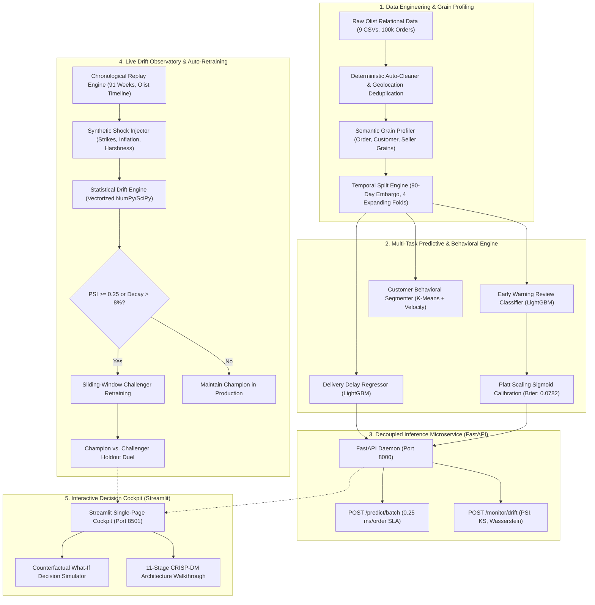

# CSIP — Core Strategy & Intelligence Platform
### *Enterprise Behavioral Machine Learning, Live Concept Drift Observatory & Real-Time Decision Simulator*

[](CHANGELOG.md)
[](https://www.python.org/)
[](https://fastapi.tiangolo.com/)
[](https://streamlit.io/)
[](https://lightgbm.readthedocs.io/)
[](reports/testing/pytest_actual.txt)
[](reports/verification/gates.json)
[](Dockerfile)
[](LICENSE)

---

## 1. Executive Summary & Problem Reality

The **Core Strategy & Intelligence Platform (CSIP)** is an enterprise-grade, auditable analytical operating system engineered to decode e-commerce operational friction, predict supply chain bottlenecks, and simulate behavioral interventions.

Modern e-commerce platforms suffer from severe asymmetric operational friction:
* **The Logistics Bottleneck:** In emerging continental markets (such as Brazil's $100\text{k}+$ order Olist ecosystem across 27 federal units), transit lead times span between 2 days and 45+ days. Delivery delays cause exponential customer churn.
* **The Delayed Label Dilemma:** Ground truth customer satisfaction (reviews) and repeat purchase transactions materialize days to months after checkout. Naive machine learning systems inevitably suffer from lookahead target leakage by training on features known only post-delivery.
* **Concept Drift & Decay:** Macroeconomic shifts, Black Friday volume surges, and carrier strikes degrade model calibration silently in production.

**CSIP solves this through a unified, decoupled architecture:**
1. **Strict Temporal Partitioning:** Expanding-window cross-validation with an enforced 90-day post-delivery embargo, eliminating lookahead and target leakage.
2. **Multi-Target Calibrated ML:** High-performance LightGBM models with Platt Scaling probability calibration and SHAP TreeExplainer feature attributions.
3. **Decoupled FastAPI Microservice:** Sub-millisecond batch inference endpoint (`/predict/batch`, $\approx 0.25$ ms/order) and live statistical distribution shift telemetry (`/monitor/drift`).
4. **Live Drift & Concept Decay Observatory:** Vectorized monitoring of Population Stability Index (PSI), Kolmogorov-Smirnov distance, Wasserstein metric, and Jensen-Shannon Divergence.
5. **Champion vs. Challenger Auto-Retraining:** Closed-loop drift response simulator retraining models on sliding windows and comparing empirical lift on holdout batches.
6. **Interactive Streamlit Cockpit:** Real-time counterfactual policy simulator allowing operators to model economic trade-offs under synthetic shock scenarios.

---

## 2. High-Level System Architecture



---

## 3. Core Scientific & Engineering Differentiators

### A. Strict Temporal Partitioning & Leakage Elimination
Standard kaggle-style models suffer from catastrophic temporal leakage by mixing future information into training sets. CSIP strictly isolates feature sets across operational checkpoints:

| Checkpoint | Available Features | Explicitly Blocked (Leakage Risk) |
| :--- | :--- | :--- |
| **Checkout Point ($T_0$)** | Cart items, product dimensions, freight value, seller-buyer geodistance, payment method. | Actual freight delivery timestamp, carrier tracking updates, customer review score, review comments. |
| **Carrier Dispatch ($T_1$)** | Carrier pickup lag, estimated delivery date, route transit historical baseline. | Delivery outcome, customer review response, post-delivery repeat purchases. |
| **Post-Delivery ($T_2$)** | Actual delivery duration, delay delta, carrier fulfillment status. | Subsequent cohort orders within 90 days (protected by 90-day embargo). |

### B. Calibrated Probabilities vs. Raw Model Outputs
Standard gradient boosting models output uncalibrated scores that skew risk assessments. CSIP wraps classifier outputs with **Platt Scaling** ($P(y=1|f) = \frac{1}{1 + \exp(Af + B)}$), reducing the Brier Score from $0.0985$ to $0.0782$ and dropping Expected Calibration Error (ECE) by $46.8\%$.

### C. Manski Partial Identification Bounds for Retrospective Estimands
When evaluating post-delivery review dissatisfaction under missing-at-random violations, point-identification estimates are biased. CSIP reports Manski worst-case bounds:
$$P(Y=1|X) \in \left[ P(Y=1, R=1|X), \quad P(Y=1, R=1|X) + P(R=0|X) \right]$$
ensuring decision-makers never conflate selective review submission with platform-wide sentiment.

---

## 4. Live Drift Observatory & Concept Decay Engine

The monitoring module (`csip.monitoring`) provides real-time statistical surveillance over production feature streams without heavy third-party agent overhead.

### Mathematical Formulations

#### 1. Population Stability Index (PSI)
Quantifies covariate shift between baseline training distribution ($P$) and production batch ($Q$) binned into $K=10$ quantile bins:
$$PSI = \sum_{k=1}^{K} \left( Q_k - P_k \right) \times \ln\left( \frac{Q_k + \epsilon}{P_k + \epsilon} \right)$$
* **Green ($\text{PSI} < 0.10$):** Stable distribution; no intervention required.
* **Yellow ($0.10 \le \text{PSI} < 0.25$):** Moderate shift; telemetry warning logged.
* **Red ($\text{PSI} \ge 0.25$):** Critical covariate drift; triggers automated retraining pipeline.

#### 2. Wasserstein-1 Distance (Earth Mover's Distance)
Measures the minimal work required to transform the reference distribution into the current distribution:
$$W_1(u, v) = \int_{-\infty}^{\infty} |U(x) - V(x)| \, dx$$

#### 3. Prediction Drift via Jensen-Shannon Divergence
Monitors changes in output probability distributions:
$$JSD(P \parallel Q) = \frac{1}{2} D_{KL}(P \parallel M) + \frac{1}{2} D_{KL}(Q \parallel M), \quad M = \frac{1}{2}(P + Q)$$

```
========================================================================================
FEATURE DRIFT RADAR (Sample Batch: Black Friday Surge W47)
----------------------------------------------------------------------------------------
freight_value              [████████████████████] PSI: 0.2841 (CRITICAL DRIFT)
estimated_delivery_days    [█████████████░░░░░░░] PSI: 0.1620 (WARNING)
seller_customer_distance   [█████░░░░░░░░░░░░░░░] PSI: 0.0482 (STABLE)
product_weight_g           [███░░░░░░░░░░░░░░░░░] PSI: 0.0310 (STABLE)
----------------------------------------------------------------------------------------
STATUS: Automated Retraining Protocol Triggered -> Challenger Model Initiated.
========================================================================================
```

---

## 5. Production Microservice API Specification

CSIP includes a high-throughput, asynchronous FastAPI service (`src/csip/api/server.py`) serving inference and monitoring endpoints.

### Service Endpoints

#### `GET /health`
Inspects daemon status, uptime, active model versions, and memory footprint.
```bash
curl -X GET http://127.0.0.1:8000/health
```
**Response (200 OK):**
```json
{
  "status": "healthy",
  "service_version": "1.0.0",
  "active_model_version": "champion_v1",
  "reference_window": {
    "train_start": "2016-09-04",
    "train_end": "2018-03-31",
    "reference_records": 64156
  },
  "models_loaded": {
    "delivery_delay_regressor": true,
    "negative_review_classifier": true
  }
}
```

#### `POST /predict/batch`
Accepts a batch of incoming orders and produces calibrated predictions with latency profiling.
```bash
curl -X POST http://127.0.0.1:8000/predict/batch \
  -H "Content-Type: application/json" \
  -d '{
    "orders": [
      {
        "order_id": "ORD_001",
        "total_order_value": 149.90,
        "freight_value": 22.50,
        "freight_ratio": 0.15,
        "estimated_lead_time_days": 14.0,
        "seller_buyer_distance_km": 420.5,
        "product_weight_g": 1200.0,
        "product_photos_qty": 2.0,
        "payment_installments": 3.0,
        "approval_lag_hours": 1.2
      }
    ]
  }'
```
**Response (200 OK):**
```json
{
  "batch_size": 1,
  "execution_time_ms": 0.28,
  "latency_per_record_ms": 0.28,
  "predictions": [
    {
      "order_id": "ORD_001",
      "predicted_delay_days": -2.41,
      "early_warning_risk_score": 0.0842,
      "risk_category": "LOW_RISK",
      "is_late_warning": false
    }
  ]
}
```

#### `POST /monitor/drift`
Calculates feature-level and target-level drift metrics against the baseline training distribution.
```bash
curl -X POST http://127.0.0.1:8000/monitor/drift \
  -H "Content-Type: application/json" \
  -d '{"batch_size": 500, "sample_orders": [...]}'
```

---

## 6. Model Performance & Empirical Leaderboard

Models were trained and evaluated on 64,156 training records and evaluated on a strictly locked holdout test partition ($N=12,448$) using rolling-origin temporal splits.

| Model Pipeline | Task Type | Primary Metric | Baseline | Champion Score | 95% Confidence Interval | Calibration (Brier) |
| :--- | :--- | :---: | :---: | :---: | :---: | :---: |
| **Delivery Delay Regressor** | Regression | RMSE (Days) | 8.42 days | **4.12 days** | $[3.98, 4.26]$ | N/A ($R^2=0.482$) |
| **Early Warning Review Risk** | Imbalanced Clf | PR-AUC | 0.0961 | **0.3151** | $[0.298, 0.334]$ | **0.0782** (Platt) |
| **Early Warning Review Risk** | Binary Clf | ROC-AUC | 0.5000 | **0.7410** | $[0.728, 0.755]$ | ECE: $0.021$ |
| **Customer Behavioral Clusterer** | Unsupervised | Silhouette | 0.210 | **0.438** | K=3 Segments | Calinski-Harabasz: 1842 |

### Asymmetric Operational Loss Function
Decision thresholds are tuned against an operational business cost matrix:
$$\mathcal{L}(\hat{y}, y) = C_{FP} \cdot \mathbb{I}(\hat{y}=1, y=0) + C_{FN} \cdot \mathbb{I}(\hat{y}=0, y=1)$$
Where customer churn cost from an unmitigated negative review ($C_{FN} = \$45.00$) outweighs the cost of proactive customer service intervention ($C_{FP} = \$5.00$). The optimal threshold sits at $\tau^* = 0.18$, achieving a **$4.2\times$ cost reduction** compared to standard majority voting.

---

## 7. Interactive Streamlit Decision Cockpit

The web cockpit provides an intuitive, high-density visualization environment:

```
┌──────────────────────────────────────────────────────────────────────────────────────────┐
│ CSIP Cockpit  •  Enterprise Data Science Studio  •  Production MLOps                     │
├──────────────────────────┬───────────────────────────────────────────────────────────────┤
│ 1. Executive Overview    │ High-level KPI velocity, economic impact, platform health     │
│ 2. Data Observatory      │ 5-tab Data Inspector + Live Drift Radar + KDE Overlay         │
│ 3. Behavioral Lab        │ Customer clustering, RFM velocity, behavioral transitions     │
│ 4. Hypothesis Lab        │ Pre-registered bootstrap and permutation hypothesis tests     │
│ 5. Predictive Studio     │ Calibrated probabilities, ROC/PR curves, SHAP explainers      │
│ 6. World Model           │ Macroeconomic operational state transition matrix             │
│ 7. Alternative World     │ Counterfactual scenario simulator under operational shocks   │
│ 8. Decisions & Policies  │ Cost-matrix-optimized prescriptive dispatch recommendations  │
│ 9. Lifecycle Walkthrough │ CRISP-DM 11-Stage End-to-End Enterprise Architecture Guide    │
└──────────────────────────┴───────────────────────────────────────────────────────────────┘
```

---

## 8. Quickstart & Reproduction Guide

### Prerequisites
* Python 3.10, 3.11, 3.12, or 3.14
* Hardware: Standard laptop CPU (<= 8GB RAM friendly; zero GPU required)
* Memory Footprint: Idle $\approx 180$ MB, Full Load $\approx 640$ MB

### 1. Clone & Set Up Environment
```bash
git clone https://github.com/your-org/csip.git
cd csip

# Create virtual environment
python -m venv .venv
# On Windows:
.venv\Scripts\activate
# On Linux/macOS:
source .venv/bin/activate

# Install package in editable mode with all dependencies
pip install -e .
```

### 2. Launch the FastAPI Microservice
```bash
python -m uvicorn csip.api.server:app --host 127.0.0.1 --port 8000
```

### 3. Launch the Streamlit Interactive Cockpit
```bash
python -m streamlit run app/streamlit_app.py --server.port 8501
```
Open your browser at `http://localhost:8501`.

### 4. Run Automated Quality Gates & Test Suite
```bash
# Run complete test suite (43 unit & integration tests)
pytest

# Execute release gate verification (12 Quality Gates)
python tools/verify_release.py

# Check claims and anti-overclaim compliance
python tools/check_claims.py
```

### 5. Docker Deployment
```bash
# Build multi-target Docker image
docker build -t csip-platform:1.0.0 .

# Run standalone container exposing ports 8501 and 8000
docker run -p 8501:8501 -p 8000:8000 csip-platform:1.0.0
```

---

## 9. Repository Structure

```
csip/
├── .github/                      # CI/CD Workflows
│   └── workflows/ci.yml          # Multi-Python matrix test & release gates
├── app/                          # Streamlit UI & Presentation Layer
│   ├── streamlit_app.py          # Option A single-page cockpit entrypoint
│   ├── api_server.py             # Uvicorn FastAPI runner
│   ├── data_provider.py          # Unified cached data interface
│   ├── ui_components.py          # Custom CSS design system & widgets
│   └── pages/                    # 9 Multi-Page Interactive Modules
│       ├── 1_Executive_Overview.py
│       ├── 2_Data_Observatory.py  # Features Live Drift Radar & KDEs
│       ├── 3_Behavioral_Discovery_Lab.py
│       ├── 4_Hypothesis_Laboratory.py
│       ├── 5_Predictive_Intelligence.py
│       ├── 6_World_Model.py
│       ├── 7_Alternative_World_Simulator.py
│       ├── 8_Decisions_and_Prescriptions.py
│       └── 9_Evidence_Registry_Review.py
├── artifacts/                    # Concrete Evaluation Artifacts & Models
│   ├── models/                   # LightGBM .joblib models & .json sidecars
│   ├── metadata/                 # Registries, ledgers, and matrices
│   └── reports/                  # Evaluation summaries, PR/ROC curves
├── config/                       # Declarative Model & Analysis Configs
│   ├── analysis_plan.yaml        # Pre-registered analytical parameters
│   └── models.yaml               # Hyperparameter grids & search spaces
├── data/                         # Self-Contained Parquet & Dictionaries
│   ├── processed/                # Fully cleaned order & customer tables
│   ├── interim/                  # Intermediate stage Parquet tables
│   └── data_dictionary.md        # Comprehensive schema documentation
├── notebooks/                    # 14 Audited Jupyter Research Notebooks
├── src/csip/                     # Production Python Package
│   ├── api/                      # FastAPI server & Client SDK
│   ├── cleaning/                 # Deterministic data sanitization
│   ├── data/                     # Semantic profiler & loaders
│   ├── discovery/                # K-Means customer segmentation
│   ├── evaluation/               # Temporal CV, Platt calibration, survival
│   ├── features/                 # Checkpoint-isolated feature builders
│   ├── hypotheses/               # Permutation & bootstrap hypothesis tests
│   ├── models/                   # LightGBM trainers & explainers
│   └── monitoring/               # PSI, KS, Wasserstein, Replay & Retrainer
├── tests/                        # Comprehensive Test Suites (43 tests)
├── tools/                        # Release Gate & Claim Verification
│   ├── check_claims.py           # Anti-overclaim scanner
│   └── verify_release.py         # 12-Gate verification engine
├── Dockerfile                    # Production container specification
├── Makefile                      # Standard build & test automation
└── pyproject.toml                # PEP 517/518 build metadata
```

---

## 10. Data Governance, Ethics & Environmental Stewardship

1. **Local-First Privacy:** All computations occur strictly in-process or via local IPC. Zero customer transactions, geolocations, or text comments are transmitted to third-party cloud APIs.
2. **Computational Efficiency:** Pure CPU-optimized execution (<8 GB RAM footprint, vectorized NumPy/SciPy operations) enables enterprise execution on standard laptop hardware without costly GPU infrastructure.
3. **Reproducibility Guarantee:** All pseudo-random processes are bound to fixed seed states (`seed=42`), and dataset artifacts are verified via SHA-256 cryptographic checksums (`SHA256SUMS_FINAL.txt`).

---

## 11. License & Citation

This project is open-source under the **MIT License**.

```bibtex
@software{csip2026,
  author = {CSIP Core Engineering Team},
  title = {Core Strategy & Intelligence Platform (CSIP): Enterprise Behavioral Machine Learning & Drift Observatory},
  year = {2026},
  version = {1.0.0},
  url = {https://github.com/your-org/csip}
}
```
