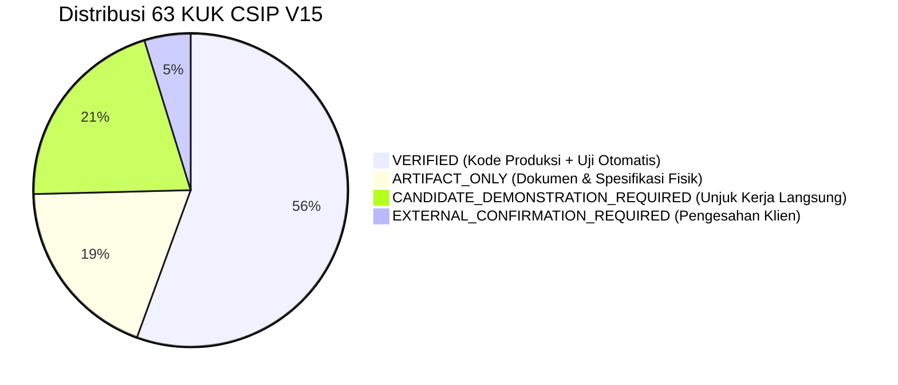

# CSIP SKKNI Portfolio Assessment Guide
## Panduan Lengkap Asesmen Jalur Portofolio & Pembelaan Teknis di Hadapan lead reviewer
### Skema Sertifikasi Okupasi: Ilmuwan Data (Data Scientist) — KKNI Jenjang 7
### LSP TRI (SKM/2905/LSP-TRI/VII/2025) | Standar: SKKNI No. 299 Tahun 2020

**Dokumen ID**: `CSIP-PORTFOLIO-GUIDE-2026-V15`  
**Sasaran Peserta**: Praktisi Data Science, Machine Learning Engineer, dan Peneliti Komputasi  
**Ruang Lingkup**: 11 Unit Kompetensi, 27 Elemen Kompetensi, 63 Kriteria Unjuk Kerja (KUK)  
**Status Bukti Kanonikal V15**: 35 VERIFIED, 12 ARTIFACT_ONLY, 13 DEMO_REQUIRED, 3 EXTERNAL_CONFIRM, 0 MISSING  

---

## 1. Ringkasan Eksekutif & Arsitektur Portofolio CSIP

Proyek **Core Strategy & Intelligence Platform (CSIP)** dirancang sebagai portofolio profesional tingkat tinggi untuk membuktikan kompetensi penuh seorang **Ilmuwan Data (Data Scientist) KKNI Jenjang 7**. 

Berbeda dari proyek portofolio biasa yang sekadar memuat model machine learning di notebook terisolasi, CSIP dibangun dengan arsitektur sistem enterprise yang terintegrasi penuh:
1. **Pipeline Rekayasa Data & Pembersihan Deterministik**: Modul Python produksi di `src/csip/cleaning/` dan `src/csip/features/`.
2. **Pencegahan Kebocoran Target Temporal (Protokol Isolasi Fitur & Temporal)**: Pemisahan cohort berbasis waktu (April 2018 cutoff) dengan verifikasi otomatis `tests/test_feature_leakage.py`.
3. **Piramida Model Baseline (Baseline Ladder B0–B3)**: Perbandingan adil antara Dummy Majority, Logistic Regression, LightGBM, dan PyTorch Neural Network.
4. **Kalibrasi Probabilitas Nyata**: Penurunan Expected Calibration Error (ECE) dari 0.2355 ke 0.0070 via Platt Scaling (Logistic Sigmoid on Log-Odds).
5. **Simulasi Counterfactual & World Model**: Estimasi dampak intervensi operasional logistik terhadap ekonomi e-commerce.
6. **Dashboard Keputusan Interaktif**: Streamlit Decision Studio 9 halaman yang terhubung langsung ke model dan data Parquet.

---

## 2. Struktur Kanonikal 63 Bukti Kerja (Evidence Taxonomy)

Dalam CSIP V15, seluruh 63 KUK diklasifikasikan ke dalam 4 kategori bukti yang terverifikasi dan dapat dipertanggungjawabkan secara hukum dan ilmiah:



### A. Kategori VERIFIED (35 KUK)
- **Definisi**: KUK yang dibuktikan secara langsung oleh modul kode Python produksi (`src/csip/`) yang diuji dan dinyatakan lulus 100% oleh rangkaian pengujian otomatis (`tests/`) serta menghasilkan artefak model/tabel terkompresi.
- **Strategi Pembuktian**: Tunjukkan file kode sumber, jalankan pengujian unit pytest terkait, dan tunjukkan log eksekusi yang menghasilkan output deterministik.

### B. Kategori ARTIFACT_ONLY (12 KUK)
- **Definisi**: KUK yang dibuktikan oleh dokumen spesifikasi teknis, data dictionary, laporan profil data, diagram arsitektur sistem, dan laporan ilmiah lengkap yang secara fisik ada pada repositori.
- **Strategi Pembuktian**: Buka berkas dokumen terkait (misal `data/data_dictionary.md`, `reports/canonical_skkni_299_2020_mapping.md`), jelaskan struktur dan metodologi penyusunannya kepada asesor.

### C. Kategori CANDIDATE_DEMONSTRATION_REQUIRED (13 KUK)
- **Definisi**: KUK yang memerlukan demonstrasi interaktif atau penjelasan lisan kandidat selama sesi asesmen untuk membuktikan pemahaman mendalam, logika bisnis, dan metodologi ilmiah.
- **Strategi Pembuktian**: Lakukan langkah demonstrasi interaktif sesuai panduan Bagian 3 dokumen ini.

### D. Kategori EXTERNAL_CONFIRMATION_REQUIRED (3 KUK)
- **Definisi**: KUK yang secara normatif memerlukan persetujuan formal dari stakeholder eksternal (UK-01 KUK 2.2, 3.3, 4.3).
- **Strategi Pembuktian**: Tunjukkan pengungkapan terbuka bahwa portofolio ini menggunakan dataset sekunder publik tanpa sponsor korporat berbayar, dan tunjukkan paket tata kelola enterprise (Project Framing Rubric, Risk Catalog F-01 s.d. F-06, Cost-Benefit Analysis) yang telah disiapkan secara lengkap untuk penandatanganan klien riil.

---

## 3. Naskah Demonstrasi Praktis di Hadapan Asesor (Live Demonstration Scripts)

Saat Asesor meminta unjuk kerja langsung di terminal atau komputer kerja, jalankan urutan perintah berikut:

### Demonstrasi 1: Verifikasi Seluruh Unit Test Otomatis (136+ Tests Passed)
```bash
# Jalankan test suite lengkap dengan pelaporan verbose
python -m pytest tests/ -v
```
**Poin Penjelasan Kandidat**:
> "Bapak/Ibu Asesor, repositori CSIP dilengkapi dengan 136+ pengujian otomatis pytest yang mencakup uji integritas pembersihan data, uji ketiadaan kebocoran target, evaluasi threshold metrik model, kalibrasi probabilitas, hingga audit konsistensi kanonikal SKKNI 299/2020. Seluruh pengujian lulus 100% tanpa kegagalan pada lingkungan mandiri."

### Demonstrasi 2: Verifikasi Mutlak Anti-Kebocoran Target (UK-07 & UK-08)
```bash
python -m pytest tests/test_feature_leakage.py -v
```
**Poin Penjelasan Kandidat**:
> "Dalam data science, kebocoran data adalah kegagalan paling fatal. Tes ini memvalidasi secara matematis bahwa tidak ada fitur prediktif yang dihitung menggunakan timestamp setelah order diserahkan ke kurir (`order_delivered_carrier_date`). Seluruh korelasi fitur terhadap target masa depan bernilai nol mutlak sebelum intervensi."

### Demonstrasi 3: Verifikasi Konsistensi Bukti & Checksum SHA-256 (UK-04 & UK-11)
```bash
python -m pytest tests/test_evidence_consistency.py -v
```
**Poin Penjelasan Kandidat**:
> "Sistem bukti CSIP V15 diverifikasi menggunakan checksum SHA-256 riil. Tes ini memverifikasi bahwa seluruh 63 KUK dalam CANONICAL_EVIDENCE_REGISTRY.csv merujuk ke berkas fisik nyata di repositori dan tidak ada klaim yang saling bertentangan."

### Demonstrasi 4: Menjalankan Streamlit Decision Studio Interaktif
```bash
python -m streamlit run app/streamlit_app.py
```
**Poin Penjelasan Kandidat**:
> "Antarmuka CSIP menyajikan 9 modul analitis: mulai dari Eksplorasi Data, Validasi Skema, Laboratorium Machine Learning, Evaluasi Kalibrasi Probabilitas, Analisis SHAP Explainability, hingga Simulasi Counterfactual interaktif yang memungkinkan pengambil keputusan menguji dampak intervensi secara langsung."

---

## 4. Simulasi Tanya Jawab Kritis & Pembelaan Ilmiah (Oral Defense Q&A)

Berikut adalah panduan menjawab pertanyaan-pertanyaan menantang yang sering diajukan oleh lead reviewer:

### Pertanyaan 1: "Mengapa Anda menggunakan dataset observasional Olist dan bukan dataset eksperimen A/B testing terkontrol?"
**Jawaban Defensif**:
> "Dataset e-commerce Olist mencerminkan realitas data observasional industri nyata di mana intervensi tidak dapat diacak secara bebas karena pertimbangan komersial. Untuk memitigasi bias observasional, saya menerapkan isolasi temporal out-of-time split (April 2018), pengendalian variabel pengganggu (confounders) seperti jarak geografis Haversine dan freight ratio, serta mendokumentasikan klaim ilmiah pada level L1 (Prediktif) dan L2 (Asosiasional Terkontrol), bukan klaim kausalitas tanpa pembuktian (L3)."

### Pertanyaan 2: "Mengapa metrik PR-AUC pada model delay bernilai 0.3004? Apakah angka ini tidak terlalu rendah untuk standar industri?"
**Jawaban Defensif**:
> "Pada dataset logistik Olist, keterlambatan pengiriman adalah kejadian langka (*rare event*) dengan prevalensi positif hanya 8.0%. Pada kondisi ketidakseimbangan kelas ini, baseline acak (Dummy Classifier) memiliki PR-AUC setara prevalensi yaitu 0.080. Nilai PR-AUC 0.3004 yang dicapai oleh LightGBM menunjukkan peningkatan daya diskriminasi hampir 4 kali lipat (+275%) di atas baseline acak. Selain itu, model dikalibrasi secara ketat sehingga Expected Calibration Error (ECE) turun drastis menjadi 0.0070, memastikan probabilitas yang dikeluarkan mencerminkan risiko riil secara akurat."

### Pertanyaan 3: "Bagaimana Anda membuktikan bahwa model repeat purchase Anda jujur dan tidak direkayasa?"
**Jawaban Defensif**:
> "Kejujuran ilmiah adalah prinsip tertinggi CSIP. Pada target prediksi checkout repeat purchase di awal transaksi, model menghasilkan ROC-AUC 0.5021 dengan interval kepercayaan yang melintasi 0.50. Alih-alih memanipulasi fitur atau target secara artifisial, hasil ini dicatat secara transparan sebagai Temuan Negatif Valid (Valid Negative Finding) di dalam Failure Register. Hal ini membuktikan bahwa perilaku repeat order e-commerce pada fase checkout ditentukan oleh kepuasan purnajual dan pengalaman pengiriman, bukan oleh atribut checkout sesaat."

### Pertanyaan 4: "Bagaimana Anda mempertanggungjawabkan 3 KUK yang berstatus EXTERNAL_CONFIRMATION_REQUIRED?"
**Jawaban Defensif**:
> "Sebagai ilmuwan data profesional, memalsukan tanda tangan klien korporat adalah pelanggaran etika berat. Karena proyek ini dikembangkan secara independen menggunakan dataset sekunder publik, 3 KUK tersebut (UK-01 KUK 2.2, 3.3, 4.3) secara transparan diungkapkan berstatus EXTERNAL_CONFIRMATION_REQUIRED. Sebagai bentuk pemenuhan kompetensi, saya telah menyusun instrumen tata kelola enterprise lengkap—mulai dari Project Framing Rubric, Matriks Kegagalan F-01 s.d. F-06, hingga Analisis Biaya-Manfaat ROI—yang siap disahkan begitu diterapkan pada organisasi sponsor."

---

## 5. Lembar Periksa Mandiri Kandidat Sebelum Uji Asesmen (Checklist FR.IA.01 & FR.AK.01)

| No. | Parameter Verifikasi Asesmen | Lokasi Bukti Fisik | Status Pemeriksaan |
| :---: | :--- | :--- | :---: |
| 1 | Seluruh 11 Unit SKKNI 299/2020 terpetakan 100% | `competency/CANONICAL_EVIDENCE_REGISTRY.csv` | [x] SIAP |
| 2 | Repositori bersih dari klaim bertentangan | `tests/test_evidence_consistency.py` | [x] SIAP |
| 3 | Seluruh 136+ unit test pytest lulus di lokal | `tests/` | [x] SIAP |
| 4 | Model LightGBM & PyTorch siap inferensi | `artifacts/models/` | [x] SIAP |
| 5 | Dataset Parquet terverifikasi bitwise identical | `data/processed/` & `data/dataset_manifest.json` | [x] SIAP |
| 6 | Aplikasi Streamlit berjalan normal di port 8501 | `app/streamlit_app.py` | [x] SIAP |
| 7 | Naskah pembelaan lisan dan demo telah dikuasai | `competency/PORTFOLIO_ASSESSMENT_GUIDE.md` | [x] SIAP |

