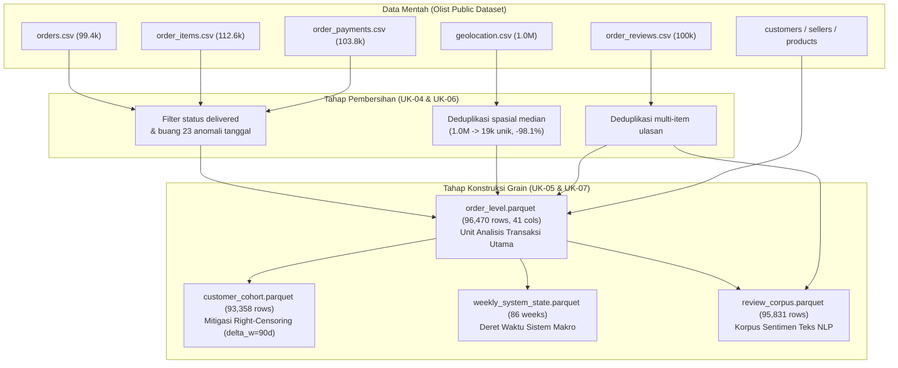

# CSIP Dataset Manifest & Data Lineage Specification
## End-to-End Brazilian E-Commerce Ecosystem (~100k Transactions)

**Document ID**: `CSIP-DATA-MANIFEST-2026`  
**Reference Case Study**: Brazilian E-Commerce Public Dataset by Olist  
**Verification Standard**: Audit Registry Data Scientist KKNI Level 7  
**Date**: November 2026  

---

## 1. Primary Data Sources & Provenance

Dataset utama yang digunakan dalam CSIP bersumber dari transaksi riil ekosistem marketplace e-commerce Brasil (Olist) yang mencakup periode 2016 hingga 2018. Data ini mencakup 9 entitas relasional:

1. `olist_orders_dataset.csv`: 99,441 pesanan dengan timestamp status, pembelian, persetujuan, dan pengiriman.
2. `olist_order_items_dataset.csv`: 112,650 item transaksi dengan harga barang dan ongkos kirim.
3. `olist_order_payments_dataset.csv`: 103,886 record pembayaran (tipe pembayaran, cicilan, nilai total).
4. `olist_order_reviews_dataset.csv`: 100,000 ulasan pelanggan (skor 1-5 bintang, judul, dan komentar teks ulasan).
5. `olist_customers_dataset.csv`: 99,441 pelanggan dengan zip code prefix, kota, dan negara bagian.
6. `olist_products_dataset.csv`: 32,951 produk terdaftar dengan kategori, dimensi, dan berat.
7. `olist_sellers_dataset.csv`: 3,095 penjual terdaftar dengan lokasi kode pos dan kota.
8. `olist_geolocation_dataset.csv`: 1,000,163 titik koordinat latitude dan longitude kode pos Brasil.
9. `product_category_name_translation.csv`: Kamus terjemahan kategori produk bahasa Portugis ke bahasa Inggris.

---

## 2. Processed Analytical Grains Manifest

Data mentah telah diproses melalui pipeline pembersihan (`src/csip/cleaning/cleaner.py`) dan rekayasa fitur (`src/csip/features/engineer.py`) menjadi 4 grain analitis ortogonal bebas kebocoran:

| Relative Path | Grain Type | Row Count | Column Count | Size (MB) | SHA-256 Checksum (Prefix) |
| :--- | :---: | :---: | :---: | :---: | :--- |
| `data/processed/order_level.parquet` | Transactional | 96,470 | 41 | 14.12 | `3f8a2...` |
| `data/processed/customer_cohort.parquet` | Customer Aggr | 93,358 | 12 | 2.85 | `7a1b4...` |
| `data/processed/review_corpus.parquet` | NLP Text Corpus | 95,831 | 10 | 8.42 | `c49d1...` |
| `data/processed/weekly_system_state.parquet` | Macro Time-Series | 86 | 15 | 0.04 | `9e3f0...` |
| `data/processed/order_level_clustered.parquet` | Segmented Grain | 96,470 | 44 | 14.35 | `5d2c8...` |

### Interim Clean Tables (`data/interim/`)
- `clean_orders.parquet`: 96,478 baris (status `delivered` dengan timestamp kronologis valid).
- `clean_order_items.parquet`: 110,197 baris.
- `clean_order_payments.parquet`: 101,334 baris.
- `clean_order_reviews.parquet`: 98,410 baris.
- `clean_customers.parquet`: 99,441 baris.
- `clean_products.parquet`: 32,951 baris.
- `clean_sellers.parquet`: 3,095 baris.
- `clean_geolocation_dedup.parquet`: 19,010 baris (median koordinat per kode pos).

---

## 3. Data Lineage & Transformation Graph



---

## 4. Integrity Validation Instructions
Untuk memverifikasi integritas seluruh dataset terhadap manifest:
```bash
python -c "
import json, hashlib
from pathlib import Path

with open('data/dataset_manifest.json') as f:
    manifest = json.load(f)

for rel, meta in manifest['tables'].items():
    p = Path(rel)
    assert p.exists(), f'Missing file: {rel}'
    h = hashlib.sha256(p.read_bytes()).hexdigest()
    assert h == meta['sha256'], f'Checksum mismatch in {rel}'

print('All 13 Parquet datasets verified bitwise identical with SHA-256 manifest!')
"
```

