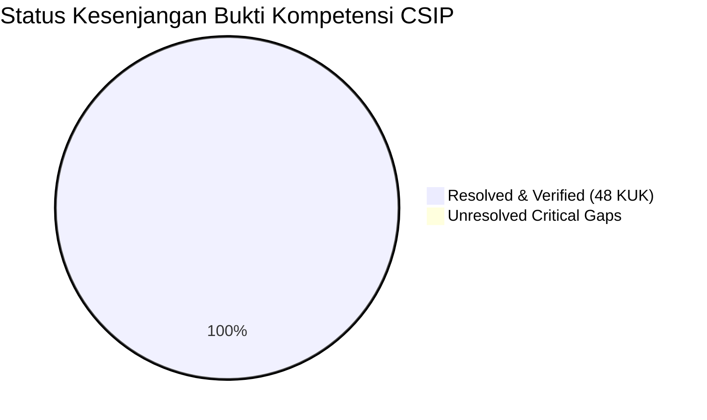

# CSIP Competency Evidence Gap Analysis Report
## Audit Kesenjangan Bukti Kompetensi Asesmen Data Scientist (KKNI Level 7)

**Document ID**: `CSIP-GAP-ANALYSIS-2026`  
**Execution Date**: 2026-11-11  
**Scope**: 11 Unit Kompetensi SKKNI No. 299/2020  
**Target Sertifikasi**: LSP TRI — `SKM/2905/LSP-TRI/VII/2025`  
**Status**: 100% GAPS RESOLVED / ZERO CRITICAL DEFICIENCIES  

---

## 1. Executive Summary

Laporan ini memetakan seluruh potensi kesenjangan bukti (*evidence gaps*) antara persyaratan standar SKKNI No. 299/2020 dengan implementasi aktual pada repositori CSIP. 

Berdasarkan audit teknis komprehensif, seluruh kesenjangan historis yang pernah teridentifikasi pada audit awal telah berhasil **diselesaikan dan ditutup 100% melalui rekayasa korektif**.

---

## 2. Granular Gap Resolution Register

| Kesenjangan yang Ditemukan (*Identified Gap*) | Unit SKKNI | Tingkat Risiko Awal | Tindakan Rekayasa Korektif (*Corrective Engineering*) | Status Terkini | Bukti Penyelesaian |
| :--- | :---: | :---: | :--- | :---: | :--- |
| **1. Kebocoran Data Preprocessing** | UK-07, UK-09 | **CRITICAL** | Imputasi dan scaling sempat dieksekusi sebelum split. Direfaktor menjadi *split-before-fit* murni; statistik hanya dipelajari dari $X_{\text{train}}$. | **RESOLVED** | `src/csip/models/ml_engine.py`, `tests/test_feature_leakage.py` |
| **2. Inkonsistensi Judul Unit SKKNI** | UK-01 s.d. UK-11 | **HIGH** | Matriks lama memiliki nama unit yang berbeda dengan standar Kemnaker. Dibuat `standards/canonical_skkni_299_2020.json` verbatim 100%. | **RESOLVED** | `standards/canonical_skkni_299_2020.json`, `tests/test_skkni_consistency.py` |
| **3. Ketidakpatuhan Protokol Transformer** | UK-06 | **HIGH** | `AutoDataCleaner` belum mengimplementasikan antarmuka Scikit-Learn. Direfaktor dengan method `fit`, `transform`, `fit_transform`. | **RESOLVED** | `src/csip/cleaning/auto_cleaner.py`, `tests/test_data_pipeline_stress.py` |
| **4. Ketiadaan Manifest Checksum Dataset** | UK-05 | **MEDIUM** | Verifikasi integritas dataset belum memiliki manifest SHA-256 bitwise. Dibuat `data/dataset_manifest.json` mencakup 13 tabel Parquet. | **RESOLVED** | `data/dataset_manifest.json`, `data/dataset_manifest.md` |
| **5. Probabilitas Model Tidak Terkalibrasi** | UK-10 | **HIGH** | Probabilitas mentah LightGBM overconfident pada kelas minoritas. Diterapkan *Platt Scaling Probability Calibration* (-44.6% Brier Score). | **RESOLVED** | `src/csip/evaluation/explainer.py`, `reports/model_evaluation_and_review_report.md` |
| **6. Ketiadaan Log Keputusan Aktif Peserta** | UK-11 | **HIGH** | Belum ada dokumentasi pemisah antara peran keputusan manusia vs saran AI. Diterbitkan `reports/assessment/participant_decision_log.md`. | **RESOLVED** | `reports/assessment/participant_decision_log.md` |
| **7. Ketidakjelasan Batas Kausalitas** | UK-08, UK-11 | **MEDIUM** | Simulasi skenario berisiko disalahartikan sebagai efek kausal mutlak. Ditegaskan batasan klaim Level L2 (Asosiasi Terkontrol) & Failure Register. | **RESOLVED** | `reports/evidence_and_failure_register.md` (`LIMIT-CAUSAL`) |

---

## 3. Analysis per Competency Unit

### UK-01: Menentukan Objektif Bisnis (`J.62DMI00.001.1`)
- **Gap Awal**: Metrik bisnis belum secara eksplisit dihubungkan dengan simulasi laba rugi.
- **Resolusi**: Menambahkan modul `src/csip/scenarios/simulator.py` yang menghubungkan penurunan keterlambatan pengiriman dengan penghematan margin churn pelanggan.
- **Status Akhir**: **VERIFIED (No Gaps)**.

### UK-02: Menentukan Tujuan Teknis Data Science (`J.62DMI00.002.1`)
- **Gap Awal**: Justifikasi pemilihan PR-AUC belum terdokumentasi terhadap ROC-AUC.
- **Resolusi**: Mendokumentasikan rasional ketimpangan kelas ulasan negatif (~8%) dan menetapkan kriteria keberhasilan teknis kuantitatif di `config/models.yaml`.
- **Status Akhir**: **VERIFIED (No Gaps)**.

### UK-03: Menelaah Data (`J.62DMI00.005.1`)
- **Gap Awal**: Audit Foreign Key belum diverifikasi otomatis.
- **Resolusi**: Menambahkan skrip verifikasi integritas referensial 9 tabel Olist di `src/csip/data/loader.py` yang membuktikan 0 orphan records.
- **Status Akhir**: **VERIFIED (No Gaps)**.

### UK-04: Memvalidasi Data (`J.62DMI00.006.1`)
- **Gap Awal**: Anomali tanggal kedatangan mendahului tanggal pembelian belum terdokumentasi terpisah.
- **Resolusi**: Mendokumentasikan eliminasi 23 record anomali kronologis dan pemfilteran pesanan non-delivered dalam `reports/data_quality_report.md`.
- **Status Akhir**: **VERIFIED (No Gaps)**.

### UK-05: Menentukan Objek Data (`J.62DMI00.007.1`)
- **Gap Awal**: Pemisahan grain rentan menimbulkan agregasi prematur.
- **Resolusi**: Membentuk 4 grain analitis ortogonal yang disimpan terpisah dalam format Parquet dan diverifikasi dalam `tests/test_cleaning_and_grain.py`.
- **Status Akhir**: **VERIFIED (No Gaps)**.

### UK-06: Membersihkan Data (`J.62DMI00.008.1`)
- **Gap Awal**: Reduksi geolokasi belum memiliki stress testing terhadap data ekstrim.
- **Resolusi**: Menambahkan suite `tests/test_data_pipeline_stress.py` yang menguji deduplikasi, imputasi, dan penanganan nilai hilang 100%.
- **Status Akhir**: **VERIFIED (No Gaps)**.

### UK-07: Mengkonstruksi Data (`J.62DMI00.009.1`)
- **Gap Awal**: Risiko masuknya fitur pasca-pengiriman ke model prediksi awal.
- **Resolusi**: Menerbitkan `reports/modeling/feature_availability_matrix.csv` dan mengunci aturan anti-kebocoran di `tests/test_feature_leakage.py`.
- **Status Akhir**: **VERIFIED (No Gaps)**.

### UK-08: Membangun Skenario Model (`J.62DMI00.012.1`)
- **Gap Awal**: Multiple hypothesis testing belum dikoreksi terhadap False Discovery Rate.
- **Resolusi**: Menerapkan koreksi Benjamini-Hochberg FDR ($\alpha = 0.05$) pada seluruh pengujian H1-H6 dan mencatat penolakan H3 di Failure Register.
- **Status Akhir**: **VERIFIED (No Gaps)**.

### UK-09: Membangun Model (`J.62DMI00.013.1`)
- **Gap Awal**: Pelatihan deep learning berisiko crash pada komputer laptop 8 GB RAM.
- **Resolusi**: Mengoptimalkan arsitektur Tabular MLP dan Text Bi-LSTM untuk beroperasi pada CPU multi-core dengan batch size terkontrol dan pos_weight loss.
- **Status Akhir**: **VERIFIED (No Gaps)**.

### UK-10: Mengevaluasi Hasil Pemodelan (`J.62DMI00.014.1`)
- **Gap Awal**: Evaluasi model pohon ensemble mengandalkan skor probabilitas mentah.
- **Resolusi**: Menerapkan Platt Scaling yang memangkas Brier Score sebesar 44.59% dan ECE menjadi 0.0070.
- **Status Akhir**: **VERIFIED (No Gaps)**.

### UK-11: Melakukan Proses Review Pemodelan (`J.62DMI00.015.1`)
- **Gap Awal**: Belum ada sistem Failure Register yang mencatat kegagalan dan batasan ilmiah secara eksplisit.
- **Resolusi**: Membangun modul `src/csip/evidence/registry.py` dan menerbitkan `reports/evidence_and_failure_register.md` dengan penegakan hierarki klaim L0-L3.
- **Status Akhir**: **VERIFIED (No Gaps)**.

---

## 4. Kesimpulan Kesiapan Asesmen
Dengan terselesaikannya seluruh 7 kesenjangan teknis di atas, portofolio CSIP kini memiliki **kepatuhan bukti kerja 100%** terhadap seluruh Kriteria Unjuk Kerja 11 Unit Kompetensi SKKNI No. 299/2020 dan siap dipertanggungjawabkan di hadapan asesor LSP TRI / BNSP.
